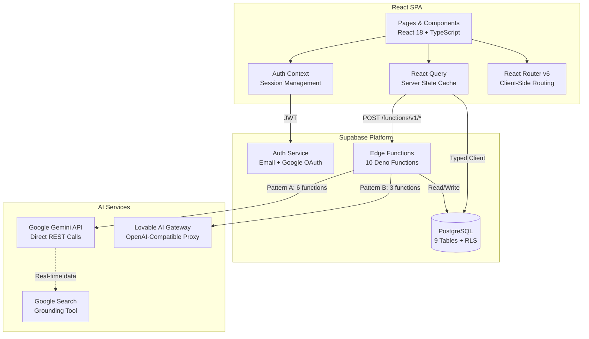
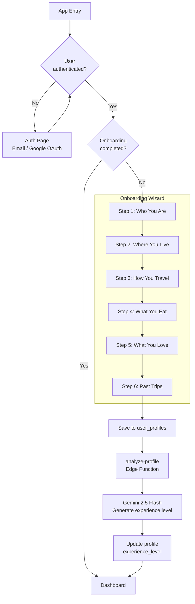
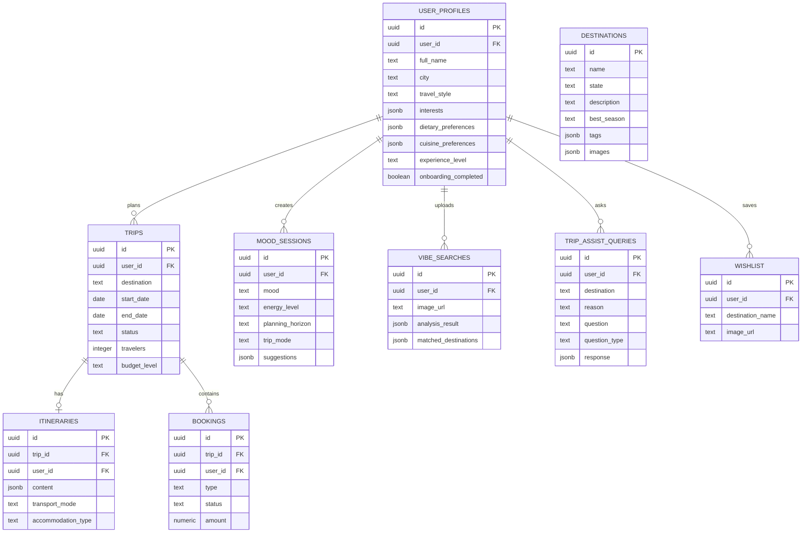
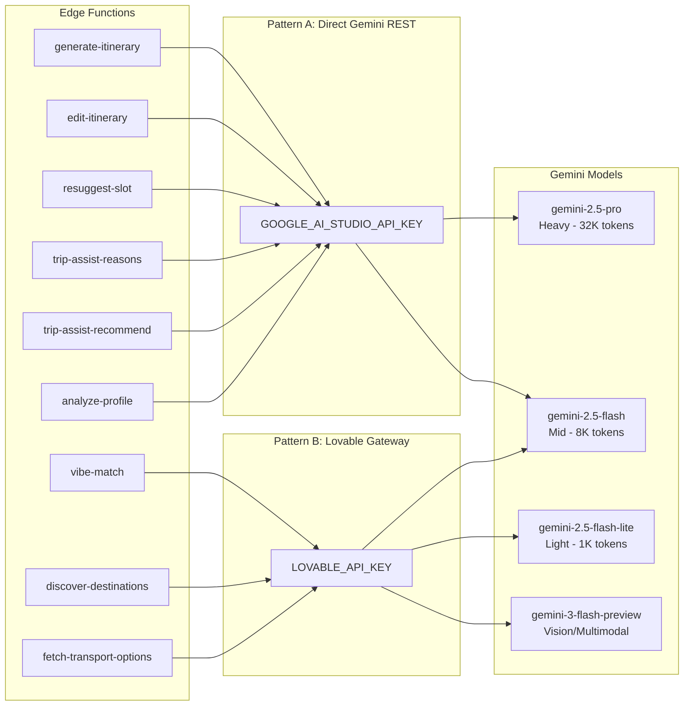
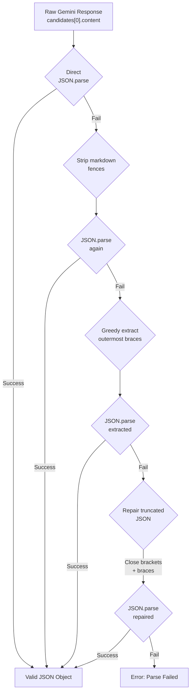
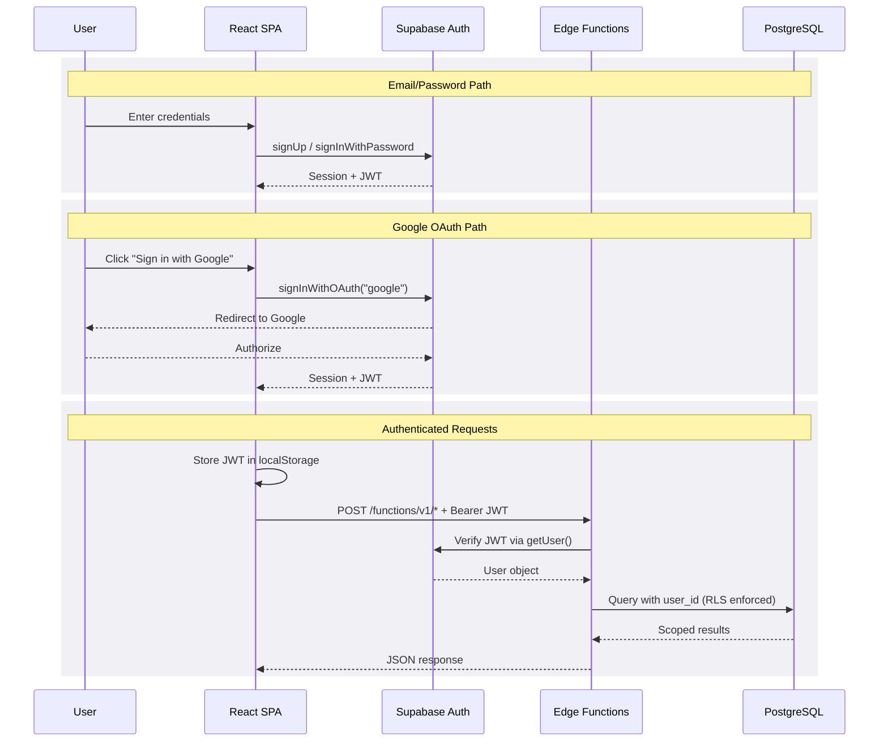
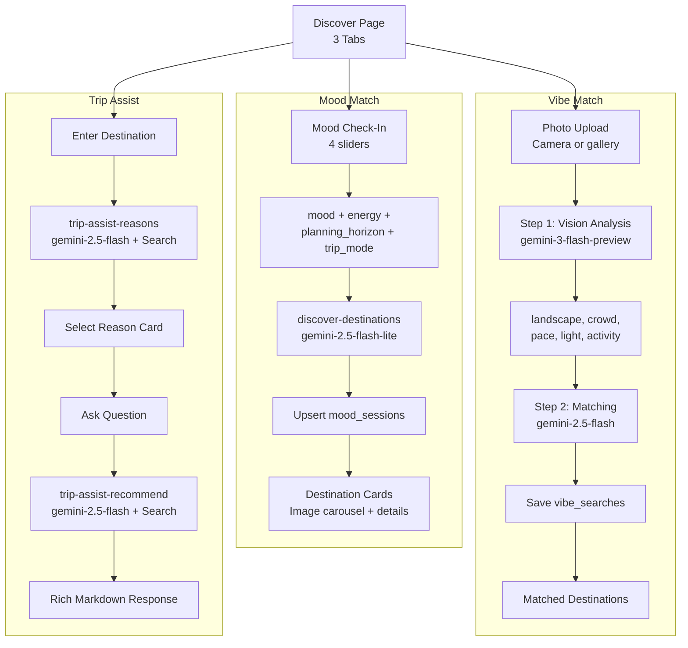
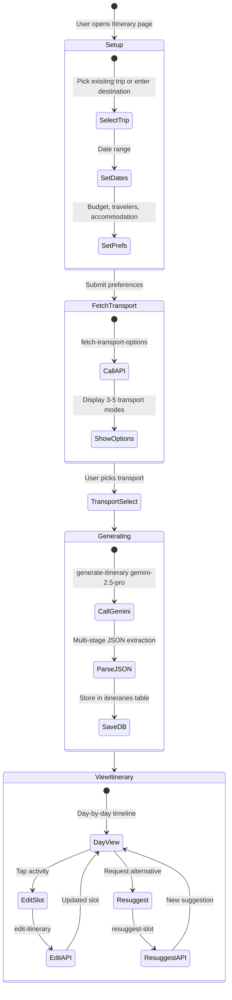
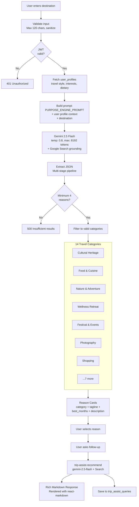

# Xcurson - AI-Powered Travel Discovery & Planning

> A Gen-Z-native travel app for Indian travellers, built with Tier 2/3 cities in mind. Pairs mood-based discovery, visual vibe matching, and a guided itinerary wizard with AI personalization to surface named, culturally-relevant picks -- not generic listicles -- grounded in real INR budgets and how Indians actually travel.

---

## Table of Contents

1. [System Overview](#1-system-overview)
2. [Architecture & Tech Stack](#2-architecture--tech-stack)
3. [Frontend Application](#3-frontend-application)
4. [Database Schema](#4-database-schema)
5. [AI Integration Layer](#5-ai-integration-layer)
6. [Edge Functions Reference](#6-edge-functions-reference)
7. [Authentication & Security](#7-authentication--security)
8. [Data Flow & User Journey](#8-data-flow--user-journey)
9. [Environment & Configuration](#9-environment--configuration)
10. [Known Gaps & Technical Debt](#10-known-gaps--technical-debt)

---

## 1. System Overview

Xcurson targets Indian travellers aged 18-28, including a large Tier 2/3 user base. The platform uses Google Gemini AI models to power:

- **Mood-based discovery** -- Check in with your current mood, energy, and planning horizon; AI ranks and scores destinations against your profile.
- **Vibe Match** -- A two-step vision pipeline extracts landscape/pace/activity attributes from a user-uploaded photo and matches them to destinations.
- **Trip Assist** -- A purpose-first conversational flow: the AI suggests *why* you're visiting (festivals, shopping, weddings, food), then provides named, priced, time-aware recommendations.
- **Itinerary generation** -- Full day-by-day itineraries with morning/afternoon/evening slots, transport alternatives, INR costs, budget summaries, and edit/undo history.
- **Transport discovery** -- Google Search-grounded AI calls to find real, bookable flights, trains, and buses with current prices.
- **Profile-driven personalization** -- A 6-step onboarding wizard captures dietary, budget, pace, mobility, companion, and cultural preferences, which flow into every AI prompt.

### Codebase Metrics

| | |
|---|---|
| **Frontend** | ~11,300 LOC TypeScript/TSX -- 10 pages, 25+ components, 4 hooks |
| **Backend** | 10 Supabase Edge Functions -- Deno runtime, 9 migrations, 9 tables |

---

## 2. Architecture & Tech Stack

### System Architecture



### Frontend Stack

| Layer | Technology | Version |
|-------|-----------|---------|
| Framework | React | 18.3.1 |
| Build tool | Vite + SWC | 5.4.19 |
| Language | TypeScript | 5.8.3 |
| Routing | React Router | 6.30.1 |
| State / data | TanStack React Query | 5.83.0 |
| Styling | Tailwind CSS + tailwindcss-animate | 3.4.17 |
| UI components | Radix UI primitives + shadcn/ui | Various |
| Animation | Framer Motion | 11.0.0 |
| Forms | React Hook Form + Zod | 7.61.1 / 3.25.76 |
| Charts | Recharts | 2.15.4 |
| Markdown | react-markdown | 10.1.0 |
| Date | date-fns | 3.6.0 |
| Testing | Vitest + Testing Library | 3.2.4 |

### Backend Stack

| Layer | Technology |
|-------|-----------|
| Platform | Supabase (hosted PostgreSQL + Auth + Edge Functions + Storage) |
| Edge runtime | Deno (Supabase Edge Functions) |
| AI provider | Google Gemini (REST API, no SDK) |
| AI gateway (secondary) | Lovable AI Gateway (OpenAI-compatible proxy to Gemini) |
| Auth | Supabase Auth (email/password + Google OAuth via Lovable) |
| External API | Wikipedia REST API (destination images) |
| Deployment | Lovable (Vite build -> CDN) |

---

## 3. Frontend Application

### Routing Structure

| Path | Component | Description |
|------|-----------|-------------|
| `/` | Index -> Auth \| OnboardingWizard \| Dashboard | Entry point: routes based on auth & onboarding state |
| `/discover` | Discover | Three-tab discovery: Mood Match, Vibe Match, Trip Assist |
| `/itinerary` | Itinerary | Setup -> transport selection -> AI generation -> day view -> edit |
| `/trips` | Trips | Trip list with planning/planned/completed status |
| `/trips/:tripId` | TripDetail | Single trip with linked itinerary & bookings |
| `/wishlist` | Wishlist | Saved destinations from discovery or vibe match |
| `/profile` | Profile | View/edit all onboarding preferences |

### Component Tree

```
App
├── AuthProvider (context)
├── QueryClientProvider (React Query)
├── BrowserRouter
│   ├── AppRoutes
│   │   ├── Index (Auth | OnboardingWizard | Dashboard)
│   │   ├── Discover
│   │   │   ├── MoodCheckIn
│   │   │   ├── TripModeSwitcher
│   │   │   ├── DestinationCard + DestinationImageCarousel
│   │   │   ├── DestinationDetail (overlay)
│   │   │   ├── VibeMatchTab (VibeInput -> VibeLoading -> VibeResults)
│   │   │   ├── TripAssistTab (destination -> reason -> question -> result)
│   │   │   └── MoodHistory
│   │   ├── Itinerary
│   │   │   ├── ItinerarySetup
│   │   │   ├── TransportOptionsView
│   │   │   ├── DayView + TimeBlockCard
│   │   │   ├── AIEditBar
│   │   │   ├── ResuggestModal
│   │   │   ├── ConfirmItineraryBar
│   │   │   ├── ItinerarySummary
│   │   │   └── ExpenseCalculator
│   │   ├── Trips / TripDetail
│   │   ├── Wishlist
│   │   └── Profile
│   └── BottomNav (6-item mobile nav)
└── Toaster + Sonner (notifications)
```

### Onboarding Wizard (6 Steps)

1. **StepWhoYouAre** -- Full name, age, gender, languages
2. **StepWhereYouLive** -- Home city and country
3. **StepHowYouTravel** -- Travel style, pace, budget, accommodation, companions, mobility
4. **StepWhatYouEat** -- Dietary restrictions, cuisine preferences
5. **StepWhatYouLove** -- Interests, cultural preferences
6. **StepPastTrips** -- Past destinations, travel frequency

On completion, the wizard saves the profile to `user_profiles` and calls the `analyze-profile` edge function, which classifies the user as `first_timer`, `building`, or `experienced`.



### Custom Hooks

| Hook | Purpose |
|------|---------|
| `useProfile` | Fetches/creates `user_profiles` row; exposes `updateProfile` mutation. Auto-creates profile on first access. |
| `useTrips` | Lists trips with `has_itinerary` and `planning_status` flags; `createTrip` and `deleteTrip` mutations (cascades itineraries + bookings). |
| `useWishlist` | Tracks wishlisted destination names in a `Set`; `toggle` inserts/deletes from `wishlist` table. |
| `useAuth` | Context hook exposing `session`, `user`, `loading`, `signOut`. |

### Design System

- **Fonts:** Outfit (display/headings), Space Grotesk (body)
- **Colors:** HSL CSS variables via Tailwind (`--primary`, `--background`, etc.) with dark mode support via class toggle
- **Components:** 49 shadcn/ui components (Radix primitives with Tailwind styling)
- **Custom classes:** `gradient-primary`, `glass` (glassmorphism), `font-display`
- **Animations:** `slide-up`, `fade-in`, `accordion-down/up` (Tailwind keyframes) + Framer Motion for page transitions and staggered lists

---

## 4. Database Schema

PostgreSQL via Supabase, with Row-Level Security (RLS) policies ensuring users can only access their own data. 9 tables across 9 migrations.

### Entity-Relationship Diagram



### Table Details

#### `user_profiles`

| Column | Type | Notes |
|--------|------|-------|
| `id` | uuid PK | Auto-generated |
| `user_id` | uuid | References auth.users |
| `full_name` | text | |
| `home_city`, `home_country` | text | Used in AI prompts for context |
| `experience_level` | text | `first_timer` \| `building` \| `experienced` (set by AI) |
| `experience_preferences` | jsonb | age, gender, languages, travel_style, pace, budget, accommodation, companions, mobility |
| `food_preferences` | jsonb | dietary, cuisines |
| `place_preferences` | jsonb | interests array |
| `cultural_preferences` | jsonb | spiritual, traditional, modern, etc. |
| `past_trips` | jsonb | Array of {destination, purpose} |
| `onboarding_completed` | boolean | Controls wizard vs dashboard routing |

#### `destinations` (reference table)

| Column | Type | Notes |
|--------|------|-------|
| `name`, `country`, `region` | text | Identity |
| `description` | text | Short blurb |
| `mood_affinities` | jsonb | Scores per mood state (burned_out, adventurous, social, reflective) |
| `landscape_type` | text[] | mountain, coastal, urban, forest, desert, tropical, rural, arctic |
| `experience_tags` | text[] | Heritage, Nightlife, Trekking, etc. |
| `dietary_friendly` | text[] | Veg-friendly zones |
| `budget_level`, `pace` | text | For matching |
| `crowd_level` | int | 1-5 scale |
| `freshness_score` | numeric | Trending/undiscovered signal |
| `visa_status_in` | text | For Indian passport holders |

#### Other Tables

| Table | Key Columns | Purpose |
|-------|------------|---------|
| `trips` | title, destination, status, trip_mode, start/end_date, traveller_count | User-created trip containers |
| `itineraries` | content (jsonb), cities[], days_count, budget_summary, edit_history[], generated_by (default `'gemini'`) | AI-generated day-by-day plans, linked to trips via trip_id FK |
| `bookings` | booking_type, title, provider, cost_amount/currency, confirmation_code, start/end_datetime | Flight/hotel/activity bookings linked to trip_id FK |
| `mood_sessions` | mood_state, energy_level, planning_horizon, trip_mode, ranked_destinations (jsonb), expires_at | Cached discovery results (time-limited) |
| `trip_assist_queries` | destination, reason, user_query, response_json, suggested_reasons, answer_summary | Trip Assist conversation history |
| `vibe_searches` | image_url_temp, extracted_vibe (jsonb), matched_destinations (jsonb), match_explanation | Photo vibe match results |
| `wishlist` | destination_name, country, fit_score, match_reason, source, experience_tags[] | Saved destinations |

---

## 5. AI Integration Layer

The application uses **Google Gemini** exclusively, via raw `fetch()` calls from Deno edge functions. There are no AI SDK packages installed. Two distinct API patterns are used.

### AI Integration Architecture



### API Pattern A: Direct Gemini REST

Used by 6 functions. Calls `generativelanguage.googleapis.com` directly with `GOOGLE_AI_STUDIO_API_KEY`.

```
POST /v1beta/models/{model}:generateContent?key={key}
{
  "contents": [{ "parts": [{ "text": "..." }] }],
  "systemInstruction": { "parts": [{ "text": "..." }] },
  "tools": [{ "google_search": {} }],
  "generationConfig": {
    "temperature": 0.7,
    "maxOutputTokens": 32768,
    "responseMimeType": "application/json"
  }
}
```

Response parsed as: `candidates[0].content.parts[0].text`

### API Pattern B: Lovable AI Gateway

Used by 3 functions. An OpenAI-compatible proxy at `ai.gateway.lovable.dev` using `LOVABLE_API_KEY`.

```
POST /v1/chat/completions
Authorization: Bearer {LOVABLE_API_KEY}
{
  "model": "google/gemini-2.5-flash-lite",
  "messages": [
    { "role": "system", "content": "..." },
    { "role": "user", "content": "..." }
  ],
  "temperature": 0.7,
  "max_tokens": 800
}
```

Response parsed as: `choices[0].message.content`

### Model Selection by Function

| Edge Function | Model | Temp | Max Tokens | Grounding | API Pattern |
|--------------|-------|------|-----------|-----------|-------------|
| generate-itinerary | `gemini-2.5-pro` | 0.7 | 32,768 | Google Search | A (Direct) |
| fetch-transport-options | `gemini-2.5-pro` | 0.5 | 4,096 | Google Search | A (Direct) |
| trip-assist-recommend | `gemini-2.5-pro` | 0.7 | 8,192 | Google Search | A (Direct) |
| trip-assist-reasons | `gemini-2.5-flash` | 0.8 | 8,192 | Google Search | A (Direct) |
| edit-itinerary | `gemini-2.5-flash` | 0.3 | 4,000 | None | A (Direct) |
| vibe-match (step 2) | `gemini-2.5-flash` | 0.3 | 1,000 | None | B (Gateway) |
| resuggest-slot | `gemini-2.5-flash-lite` | 0.8 | 800 | None | A (Direct) |
| discover-destinations | `gemini-2.5-flash-lite` | 0.7 | 800 | None | B (Gateway) |
| analyze-profile | `gemini-2.5-flash-lite` | default | default | None | B (Gateway) |
| vibe-match (step 1) | `gemini-3-flash-preview` | 0.1 | 350 | None | B (Gateway) |

### JSON Response Parsing Pipeline

All AI responses go through a shared extraction pipeline in `_shared/extract-json.ts`:



### Purpose Engine System Prompt

The `trip-assist-reasons` and `trip-assist-recommend` functions share a 400+ line system prompt (`_shared/purpose-engine-prompt.ts`) that defines:

- **14 travel purpose categories:** festival_event, iconic_tourism, religious_pilgrimage, food_cuisine, shopping_goods, wedding_family, wellness_retreat, adventure_outdoor, solo_self_discovery, bleisure_workation, content_creation, screen_inspired, education_campus, sports_fan
- **India-specific context weighting** -- religious sites, wedding seasons, "Goods Getaways"
- **Anti-hallucination rules** -- no invented names, approximate dates only, honest uncertainty
- **Strict JSON output schemas** for both `suggest_reasons` and `generate_recommendations` tasks
- **Voice/tone guide** -- friend-who-lived-there register, no "vibrant" or "bustling", INR price bands

---

## 6. Edge Functions Reference

| Function | Trigger | Input | Output |
|----------|---------|-------|--------|
| `analyze-profile` | Post-onboarding | User's past_trips, travel frequency, interests | Sets `experience_level` on user_profiles |
| `discover-destinations` | Mood Check-In submit | mood_state, energy_level, planning_horizon, trip_mode | Ranked array of destinations with fit_score and match_reason; saved to mood_sessions |
| `fetch-destination-images` | After discovery results load | Array of {name, country} | Map of destination name -> image URLs (Wikipedia API, not AI) |
| `trip-assist-reasons` | User enters destination in Trip Assist | destination string + user profile signals | 6 ranked reasons with category, tagline, time_relevance, specific_anchor, dates |
| `trip-assist-recommend` | User picks reason and asks a question | destination, reason, user_query, full context | 4-6 recommendations + packing list + watch-outs + follow-ups; persisted to trip_assist_queries |
| `fetch-transport-options` | Itinerary setup submit | from, to, start_date, trip_mode | 3-6 transport options (flights/trains/buses) with prices, durations, booking tips |
| `generate-itinerary` | After transport selection | cities, days, trip_mode, start_date, profile, transport choice | Full itinerary JSON (days -> slots -> activities, costs, budget summary); saved to itineraries |
| `edit-itinerary` | User submits natural-language edit | Current itinerary content + edit instruction | Updated itinerary content + change summary; edit logged in edit_history |
| `resuggest-slot` | User taps "resuggest" on a time block | Current slot context + full itinerary | 3 alternative activities for the slot |
| `vibe-match` | User uploads a travel photo | Base64 image URL | Step 1: extracted vibe attributes. Step 2: matched destinations with fit_score; saved to vibe_searches |

All edge functions follow a common pattern: CORS headers for `OPTIONS` preflight, JWT-based user auth verification via Supabase service role, input validation, AI call, JSON response extraction, and structured error responses (401/400/502/500).

---

## 7. Authentication & Security

### Auth Flow



### Security Model

- **Client-side:** Only Supabase anon key exposed (`VITE_SUPABASE_PUBLISHABLE_KEY`). No AI keys or service role keys in the browser.
- **Edge functions:** Authenticate users by extracting the JWT from the `Authorization` header and verifying via `supabase.auth.getUser()` with the service role key.
- **Row-Level Security (RLS):** All tables have RLS policies; users can only read/write their own rows (filtered by `user_id = auth.uid()`).
- **Session management:** Supabase Auth with `localStorage` persistence and auto token refresh.
- **AI API keys:** Stored as Supabase Edge Function secrets, never sent to the client.

---

## 8. Data Flow & User Journey

### Discovery Features



Results cached in `mood_sessions` with a TTL (`expires_at`). Returning users see their last session until it expires.

### Itinerary Generation Flow



### Trip Assist with Purpose Engine



---

## 9. Environment & Configuration

### Client-Side Environment Variables

| Variable | Purpose |
|----------|---------|
| `VITE_SUPABASE_URL` | Supabase project URL |
| `VITE_SUPABASE_PUBLISHABLE_KEY` | Supabase anon/public key (safe for client) |
| `VITE_SUPABASE_PROJECT_ID` | Supabase project identifier |

### Edge Function Secrets (Server-Side Only)

| Secret | Used by | Purpose |
|--------|---------|---------|
| `GOOGLE_AI_STUDIO_API_KEY` | 6 functions (Pattern A) | Direct Gemini REST API authentication |
| `LOVABLE_API_KEY` | 3 functions (Pattern B) | Lovable AI Gateway proxy authentication |
| `SUPABASE_URL` | All functions | Auto-injected by Supabase |
| `SUPABASE_SERVICE_ROLE_KEY` | All functions | Auto-injected; used for server-side auth verification |

### Build Configuration

- **Vite** with `@vitejs/plugin-react-swc` for fast JSX transform
- **Path alias:** `@/` -> `./src/`
- **Dev server:** port 8080, dual-stack (`::`), HMR overlay disabled
- **TypeScript:** Project references (`tsconfig.app.json` + `tsconfig.node.json`), `strictNullChecks: false`, `noImplicitAny: false`
- **Lovable tagger:** Development-only plugin for component tracking

---

## 10. Known Gaps & Technical Debt

| Area | Issue | Severity |
|------|-------|----------|
| TypeScript | `strictNullChecks` and `noImplicitAny` both disabled; liberal use of `any` casts across pages | Medium |
| Tests | Only a placeholder test file (`example.test.ts`) exists; zero functional test coverage | **High** |
| Error handling | Edge function errors surface as generic "non-2xx status code" to the user; actual Gemini error details are logged server-side but not displayed | Medium |
| API key split | 3 functions use Lovable's gateway (LOVABLE_API_KEY) and 6 use direct Gemini (GOOGLE_AI_STUDIO_API_KEY); consolidating to one pattern would simplify ops | Low |
| FK cascades | No database-level CASCADE on trip deletion; the `useTrips` hook manually deletes itineraries and bookings first | Medium |
| Rate limiting | No rate limiting on edge function invocations; a user could burn through Gemini quota rapidly | Medium |
| Caching | No response caching for identical AI queries; each call is a fresh Gemini request | Low |
| Accessibility | Limited ARIA attributes; no keyboard navigation testing; colour-contrast gaps in some muted text | Medium |
| Auth.tsx | Nested `<h1>` tags on line 53 (double-wrapped heading) | Low |
| Itinerary content | Stored as untyped `jsonb`; no schema validation on the JSON shape returned by AI | Medium |

---

*Xcurson Technical Specification -- October 2026 -- Generated from codebase analysis*
